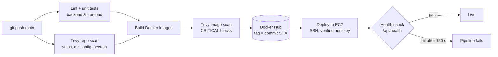
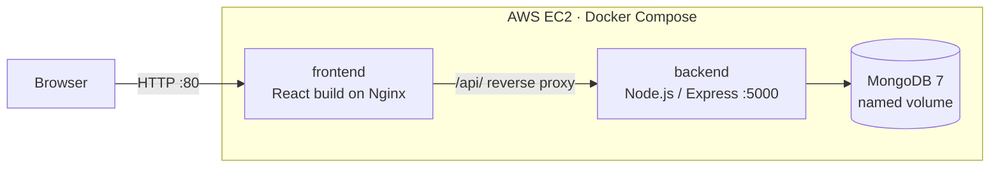

# Expense Tracker: DevSecOps CI/CD Pipeline to AWS EC2

A containerized 3-tier web app (React + Node.js/Express + MongoDB) shipped by a **DevSecOps pipeline**. Every push to `main` is linted, tested and security-scanned with **Trivy**. The pipeline builds and scans the Docker images, pushes them to **Docker Hub** with commit-SHA tags, and deploys them automatically to **AWS EC2** with a health-checked rollout. Any failed gate blocks everything after it.


## Pipeline



| Stage | What it does | Blocks on |
|---|---|---|
| `quality` | ESLint, Node test runner and a production build for backend and frontend | any lint error or failing test |
| `trivy-repository` | Scans source and dependencies for vulnerabilities, misconfigurations and leaked secrets | any CRITICAL finding or scanner error |
| `image-build-scan-push` | Builds both images, scans each one, and pushes to Docker Hub **only if the scans pass** | CRITICAL image CVE, build or push error |
| `deploy` | Verifies the EC2 SSH fingerprint, uploads the Compose file, pulls the new images, restarts and health-checks (30 tries) | SSH failure, fingerprint mismatch, failed health check |

Pull requests run only the quality and repository-scan stages. Only `main` publishes and deploys.

## Application architecture



- **Only port 80 is public.** Nginx serves the React app and proxies `/api/` to the backend over the private Docker network. MongoDB is never exposed.
- **Multi-stage frontend image:** Node builds the app, and only the static files ship on `nginx:alpine`.
- **Data survives redeploys** through the `mongo-data` named volume.
- **REST API:** create, list, filter and summarize expenses by category and date range, plus `/api/health` for the deploy check.

## What I built

- **Shift-left security:** Trivy scans the repository (dependencies, Dockerfile and config misconfigurations, secrets) *and* every image before it can reach a registry.
- **Immutable releases:** images are tagged with the Git commit SHA, never `latest`, so every deployment traces back to an exact commit and a rollback means redeploying an old tag.
- **Secure deployment over SSH:** the runner compares the EC2 host key with a pre-verified SHA256 fingerprint before connecting (no blind `StrictHostKeyChecking=no`). The Docker Hub token reaches the server over SSH stdin, never in a command line or file.
- **Secrets management:** the SSH key and Docker Hub token are GitHub Actions secrets, with the `production` environment and a concurrency lock to prevent overlapping deploys.
- **Testable backend design:** Express routes (`app.js`) are separated from the database and listener (`server.js`), so the API tests run without MongoDB and exit cleanly.

## Results

- **All 4 stages green:** lint and tests, repo scan, image build/scan/push, and EC2 deploy with a passing health check. A full run takes **~2 min 40 s** from push to live.
- **Debugged a broken pipeline:** the first runs failed with `Unable to resolve action aquasecurity/trivy-action@0.33.1`. That action version didn't exist, so I pinned a valid release (`v0.36.0`) and the pipeline went green.

## Repository structure

```text
.
├── .github/workflows/devsecops.yml   # 4-stage CI/CD pipeline
├── backend/                          # Express API, Mongoose model, node:test tests, Dockerfile
├── frontend/                         # React (Vite) app, Nginx config, multi-stage Dockerfile
├── docker-compose.yml                # local: builds images from source
├── docker-compose.prod.yml           # EC2: pulls SHA-tagged images from Docker Hub
├── .env.example                      # sample configuration (no secrets)
└── docs/lab-guide.md                 # full setup guide, exercises, troubleshooting
```

## Run it locally

**Prerequisites:** Docker with the Compose plugin; Node.js 22 to run lint and tests.

```bash
docker compose up -d --build
curl -f http://localhost/api/health      # {"status":"ok", ...}
# open http://localhost
docker compose down                      # keeps the database volume
```

Lint and tests:

```bash
cd backend  && npm install && npm run lint && npm test
cd ../frontend && npm install && npm run lint && npm test && npm run build
```

## Deploy your own

1. Launch an Ubuntu EC2 instance with Docker and Compose v2. Open port 80, and port 22 only to a trusted source.
2. Create the Docker Hub repositories `expense-backend` and `expense-frontend`, plus an access token.
3. Add to **Settings → Secrets and variables → Actions**:

   | Name | Type |
   |---|---|
   | `EC2_HOST`, `EC2_USER`, `EC2_HOST_FINGERPRINT`, `DOCKERHUB_USERNAME` | Variables |
   | `EC2_SSH_KEY`, `DOCKERHUB_TOKEN` | Secrets |

4. Push to `main`.

Full steps, including how to verify the host fingerprint safely, are in [`docs/lab-guide.md`](docs/lab-guide.md).

## Screenshots

<!-- Add images to docs/screenshots/ and uncomment:


-->

## Challenges and what I learned

- **Pin versions that exist.** A non-existent action tag fails the job before any step runs. Reading the exact error line found the cause in seconds.
- **A clean Trivy scan isn't proof of security.** It only finds *known* issues in its database, so the gate blocks CRITICAL findings while lower severities stay visible without blocking.
- **Separate the app from its side effects.** Splitting `app.js` from `server.js` made the API testable in CI without a database.
- **Host-key verification matters in CD.** Disabling it would let a spoofed server receive the deploy credentials.

## Possible improvements

- HTTPS with a domain (Let's Encrypt or an ALB with ACM)
- Switch to `npm ci` with the committed lockfiles and pin actions and base images by digest
- Automatic rollback to the previous SHA when the health check fails
- MongoDB authentication and scheduled backups
- Replace SSH deploys with AWS SSM or ECS, and define the EC2 host in Terraform

---

Built during the bongoDev DevOps bootcamp, 2026.
